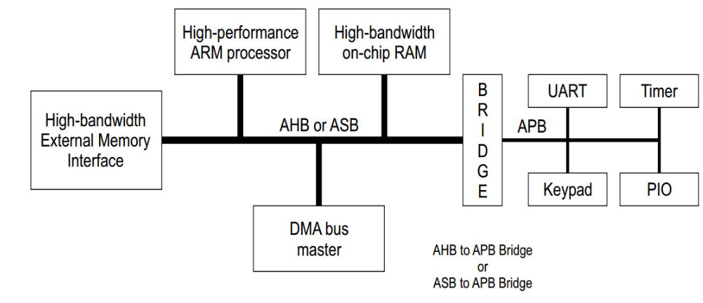

# AHB to APB Bridge

## Project Overview

The AHB to APB Bridge is a hardware interface that connects the high-performance AHB (Advanced High-performance Bus) to the low-power APB (Advanced Peripheral Bus).

The bridge enables communication between high-speed system components and slower peripheral devices by converting AHB transactions into APB-compatible transfers.

This project was completed as part of online VLSI training at Maven Silicon.

## Project Objectives

- Understand AHB and APB bus protocols.
- Study the working of an AHB-to-APB bridge.
- Understand protocol conversion between the two buses.
- Analyze address, control, and data transfer.
- Study the simulation waveform and RTL synthesis results.

## Key Concepts

- AHB Interface
- APB Interface
- Address and Data Phases
- Protocol Conversion
- Transaction Latching
- Read and Write Operations
- Simulation Waveform
- RTL Synthesis

## Important Signals

### AHB Signals
- HADDR
- HTRANS
- HWRITE
- HSIZE
- HBURST
- HREADY
- HWDATA
- HRDATA

### APB Signals
- PADDR
- PWRITE
- PSEL
- PENABLE
- PWDATA
- PRDATA
- PREADY

## Project Documentation

The project report includes:

- Protocol explanation
- Bridge operation
- Block diagram and architecture
- Simulation waveform
- RTL synthesis
- Conclusion

## Tools and Implementation

This project focuses on understanding the AHB-to-APB bridge architecture, protocol conversion, simulation waveform, and RTL synthesis.

## Block Diagram & Architecture

The following diagram illustrates the architecture of the AHB-to-APB Bridge and how it connects the high-performance AHB bus with the low-power APB bus.

## Project Report

Refer to the PDF file in this repository for the detailed project documentation.
